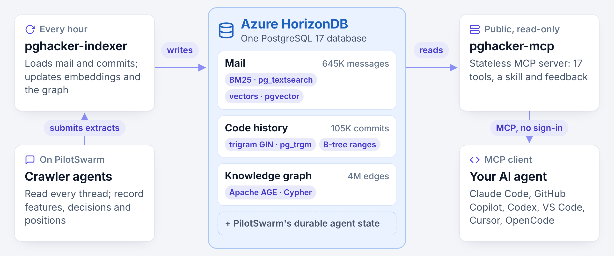

# pghacker-mcp

[](#use-it)
[](#use-it)
[](#use-it)
[](#use-it)
[](#use-it)
[](#use-it)
[](#use-it)

pghacker-mcp answers questions about PostgreSQL's design history and source code, with citations. Ask why a feature works as it does, or what happened to SQL/PGQ, and an agent finds the pgsql-hackers threads, commits and code that answer it, and quotes them.

The project is powered by PostgreSQL itself. The mail, the graph and PostgreSQL's full commit history, live in [Azure HorizonDB](https://azure.microsoft.com/products/horizondb) (PostgreSQL when run locally), and PostgreSQL indexes do the searching: trigram for code and text, vector for semantic search, BM25 for full-text search, and B-trees over the history's commit ranges, with Apache AGE for the graph. Typical searches across the whole commit history return in milliseconds.



## Quick start

You need Node.js 24 or later, Rust (the toolchain in `rust-toolchain.toml`), and Docker with Docker Compose, on macOS or Linux.

```bash
npm run setup   # download PilotSwarm, install dependencies, build, and create .env
npm start       # start PostgreSQL, both services, PilotSwarm's worker and portal, and the home page
npm run load    # load two months of pgsql-hackers and PostgreSQL's commit history
```

`npm start` runs the app in the background (`--foreground` keeps it in the terminal), logging to `.runtime/logs/`; the first start builds the Rust services, which takes a few minutes. `npm run stop` stops it and keeps the data. `npm run load` loads the data (see [Load the data](#load-the-data)). Then add the MCP URL from the home page to your agent; [Use it](#use-it) lists the tools.

| What | Address |
| --- | --- |
| The home page: the MCP URL, how to add it to an agent, and examples | http://127.0.0.1:3001 |
| The portal, to chat with the agents | http://127.0.0.1:3001/portal/ |
| pghacker-mcp, for your MCP client | http://127.0.0.1:3102/mcp, or http://127.0.0.1:3001/mcp |
| pghacker-indexer, for the crawler agents | http://127.0.0.1:3101/mcp |
| PostgreSQL 17 | 127.0.0.1:55433 |

Everything listens on 127.0.0.1 only, and the portal has no sign-in, so **don't expose it**.

The MCP tools need no language model. Only the portal's agents and extraction (`npm run crawl`) do: set `GITHUB_TOKEN` in `.env` or your shell for GitHub Copilot's models, or add another provider in the portal's Admin Console. For semantic search, set the embedding settings, `HORIZON_EMBED_*`, in `.env` (`.env.example` shows them); without them, the mail searches use full text only. The [reference](docs/reference.md#configuration) lists every setting.

## Load the data

Locally, pghacker-mcp works on a slice of the data. `npm run load` loads it, and starts the app first if it isn't running:

```bash
npm run load              # the mail, then PostgreSQL's whole commit history
npm run load -- --quick   # the mail, and the history of src/backend/parser only
```

It shows its progress and ends with what to do next. The first load takes about 15 minutes. Run it again at any time: it skips what's done. `--mail-only` and `--code-only` load one part, and `--force` rebuilds the history. The [reference](docs/reference.md#running-locally) shows how to do each step by hand.

1. **Mail.** Two months of pgsql-hackers, June–July 2026 (about 5,500 messages), and 14 whole threads on SQL/PGQ and SQL/JSON (`config/test-slices.toml`).
2. **Code.** PostgreSQL's whole commit history, every branch, tag and commit, from git.postgresql.org. The indexer applies new commits every hour.
3. **Extraction.** Features, decisions and authors' positions, which `search_extracts` and `author_perspective` read, come from crawler agents. They need a language model: add a token with `echo "GITHUB_TOKEN=$(gh auth token)" >> .env` and restart with `npm run stop && npm start` (or add a provider in the portal's Admin Console). Then:

   ```bash
   npm run crawl -- --pilot              # 10 threads in one session, to review first
   npm run crawl -- --concurrency 8      # then the rest, 8 sessions at a time
   npm run crawl -- --dedup              # then one session that merges duplicates
   ```

## Use it

Connect any MCP client to `http://127.0.0.1:3102/mcp`, or ask a **pghacker Evaluator** session in the portal. Answers cite Message-IDs, verbatim quotes, commit SHAs and file paths.

| Area | pghacker-mcp's tools |
| --- | --- |
| Mail | `search_threads`, `get_thread`, `search_extracts`, `author_perspective`, `search_authors`, `get_author` |
| Code | `search`, `grep`, `read_file`, `list_files` and `blame`, at any commit; `get_commit` and `search_commits`, like `git show` and `git log`; `search_patches`, in the patches posted to the list |
| SQL and graph | `get_ontology` describes the data; `query` runs one read-only SQL statement, Cypher included |

It also serves a skill, [`review-as-author`](skills/review-as-author/SKILL.md): a review of a patch, commit or design as a given pgsql-hackers author would give it (Tom Lane, say), each point quoting that author's own messages. Clients that support MCP's skills extension get it at `skill://review-as-author/SKILL.md`; the others get a tool, `load_skill_review_as_author`, which returns it, and instructions that say to call it. A user can also attach the skill as a resource, or install the folder as a skill in an agent; the [reference](docs/reference.md#skills) explains.

## Check it

```bash
npm test             # the launcher, configuration, readiness and evaluation helpers
npm run rust:check   # rustfmt, clippy and the Rust tests
npm run smoke        # with the app running: both servers and their skills, the portal, the worker and the agents
npm run eval         # with the data loaded (npm run load): 30 questions (eval/questions.json), into eval/RESULTS.md
npm run eval -- --questions eval/reviews.json --skill skills/review-as-author/SKILL.md --results eval/RESULTS-reviews.md
```

The last reviews 14 patches as their actual reviewers would have (10 they objected to, 4 they welcomed), with the `review-as-author` skill in the prompt; without `--skill`, the agents must load it on their own, with `load_skill_review_as_author`.

## Deploy to Azure

[deploy/README.md](deploy/README.md) deploys the app to Azure Kubernetes Service with Terraform and Kubernetes manifests, starting from the local corpus. There, the home page and `/mcp` are public, the portal, at `/portal/` on Front Door's own host name, requires GitHub sign-in, and the indexer takes whatever sources its users ask for. PilotSwarm's agents, which read mail that anyone can post and run shell commands, run on a node pool of their own that has no internet: they reach only the indexer's tools, pghacker-mcp, the model proxy and their database.

## Privacy and telemetry

The software may collect information about you and your use of the software and send it to Microsoft. Microsoft may use this information to provide services and improve our products and services. You may turn off the telemetry as described in the repository. There are also some features in the software that may enable you and Microsoft to collect data from users of your applications. If you use these features, you must comply with applicable law, including providing appropriate notices to users of your applications together with a copy of Microsoft's privacy statement. Our privacy statement is located at https://go.microsoft.com/fwlink/?LinkID=824704. You can learn more about data collection and use in the help documentation and our privacy statement. Your use of the software operates as your consent to these practices.

### Turning telemetry off

- **Deployed with this repository's Terraform:** telemetry is off unless your `.tfvars` sets `usage_enabled = true`. To turn it off, set `usage_enabled = false`, or remove the line, and run `terraform apply`. No Application Insights resource is created and the app gets no connection string, so nothing is sent.
- **Run any other way:** `npm start` never sends telemetry, and the binaries on their own send none unless `PGHACKER_USAGE_ENDPOINT` is set.

## Learn more

- [Blog post](https://techcommunity.microsoft.com/blog/adforpostgresql/using-postgresql-to-reflect-on-its-own-history-and-code-introducing-pghacker-mcp/4566611): what pghacker-mcp can do, and how it works.
- [Reference](docs/reference.md): settings, tools and their limits, the commit history, the graph, extraction, tests and the repository's layout.
- [Design](docs/design.md): why pghacker-mcp exists, and its plan.
- [Search design](docs/search-design.md): how the code tools read every commit.
- [Deployment](deploy/README.md): Azure, upgrades and operations.

## Feedback

Tried it? We'd love to hear what worked, what didn't and what you'd like next: share your feedback, questions and ideas in [Discussions](https://github.com/Azure-Samples/pghacker-mcp/discussions). Report a bug in [Issues](https://github.com/Azure-Samples/pghacker-mcp/issues), and a security vulnerability as [SECURITY.md](SECURITY.md) says.

## Contributing

This project welcomes contributions and suggestions. Most contributions require you to agree to a
Contributor License Agreement (CLA) declaring that you have the right to, and actually do, grant us
the rights to use your contribution. For details, visit [Contributor License Agreements](https://cla.opensource.microsoft.com).

When you submit a pull request, a CLA bot will automatically determine whether you need to provide
a CLA and decorate the PR appropriately (e.g., status check, comment). Simply follow the instructions
provided by the bot. You will only need to do this once across all repos using our CLA.

[CONTRIBUTING.md](CONTRIBUTING.md) explains how to build, check and propose a change, and [SUPPORT.md](SUPPORT.md) how to get help.

## Code of conduct

This project has adopted the [Microsoft Open Source Code of Conduct](https://opensource.microsoft.com/codeofconduct/).
For more information see the [Code of Conduct FAQ](https://opensource.microsoft.com/codeofconduct/faq/) or
contact [opencode@microsoft.com](mailto:opencode@microsoft.com) with any additional questions or comments.

## Security

**Please do not report security vulnerabilities through public GitHub issues.** To report one, follow [SECURITY.md](SECURITY.md), which points to Microsoft's reporting guidance for its repositories at [https://aka.ms/SECURITY.md](https://aka.ms/SECURITY.md).

## Disclaimers

MCP is a new and developing standard. As with all new technology standards, you should review the security of any systems that integrate with MCP servers, such as MCP hosts, clients, agents, AI applications, and models and confirm that they comply with system requirements, standards, and expectations. You should follow Microsoft security guidance for MCP servers, including enabling Entra ID authentication, secure token management, and network isolation. Refer to [Microsoft Security Documentation](https://learn.microsoft.com/azure/api-management/secure-mcp-servers) for details.

This MCP server may provide access to underlying resources, such as tools, services, and/or data. Your use of that underlying resource via this MCP server is governed by the underlying resource's license terms.

## Trademarks

This project may contain trademarks or logos for projects, products, or services. Authorized use of Microsoft
trademarks or logos is subject to and must follow
[Microsoft's Trademark & Brand Guidelines](https://www.microsoft.com/legal/intellectualproperty/trademarks/usage/general).
Use of Microsoft trademarks or logos in modified versions of this project must not cause confusion or imply Microsoft sponsorship.
Any use of third-party trademarks or logos are subject to those third-party's policies.

## License

pghacker-mcp is licensed under the [MIT License](LICENSE). [NOTICE](NOTICE) lists the third-party code in this repository and its license.
