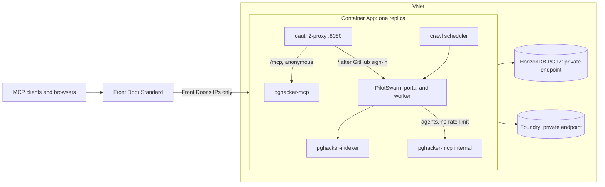

# Deploying pghacker-mcp to Azure

This deploys pghacker-mcp in production mode. Users index whatever they ask for, and the deployment starts with the local corpus. [TERRAFORM.md](TERRAFORM.md) documents the Terraform itself: variables, outputs, secrets and state.



- **`https://<front door>/mcp`** is the public MCP endpoint. It is anonymous and read-only, rate-limited per client (`X-Azure-ClientIP`, IPv6 by /64), and serves only requests that came through this Front Door profile (`X-Azure-FDID`).
- **`https://<front door>/`** is the PilotSwarm portal. Users sign in with GitHub, and only members of example-org/example-team (or `github_users`) get in. Members are PilotSwarm `user`s (`portal_role`).
  - oauth2-proxy tells the portal who signed in through headers, which PilotSwarm's `proxy` auth provider reads. PilotSwarm 0.8.2's browser app doesn't support that provider, so the image patches support in (`scripts/lib/portal-spa.mjs`).
  - The patch is pinned to the release's bundle and fails the build on any other: re-check it when upgrading PilotSwarm, and drop it once [microsoft/PilotSwarm#154](https://github.com/microsoft/PilotSwarm/issues/154) is fixed.
- **Models** come from Azure AI Foundry: `gpt-6.1-sol` is the portal's default, `gpt-6-luna` runs extraction and deduplication, and `text-embedding-3-small` does embeddings. The subscription's policy refuses keys, so the app calls them with its managed identity: a proxy in the supervisor adds an Entra token to each request (`scripts/lib/foundry.mjs`), and nothing in the container holds a key.
- **Production mode**:
  - `add_source` takes any list of the postgresql.org archive (chosen months, a range, or the whole archive, plus seed threads) and any branch, tag or commit of PostgreSQL.
    - A list added without months, `follow` included, queues the whole archive.
    - Every code snapshot is kept. The code tools read a version's latest (its newest commit: the branch head, else its newest release), or the newest release line when no version is given; any other snapshot is readable by release (`18.3`), ref or commit SHA.
  - `follow` retrieves a list's current month again every hour.
  - The indexer's job workers have lanes. Worker 0 runs the recurring jobs, worker 1 runs anything, and the rest never take code snapshots, so a batch of snapshots loads one at a time while mail keeps flowing.
  - The crawl scheduler keeps extraction sessions busy as long as threads wait, as fast as Foundry allows: it starts 8, adds one a minute while saturated, halves on a 429, and stops at `crawl_max_sessions`. It runs deduplication as extracts arrive.
  - There are no caps on scope or spend. Every thread of whatever users add gets extracted by `gpt-6-luna`.

## The container

`scripts/container.mjs` runs as root under tini. It starts the Foundry proxy on loopback and bootstraps the database (creating it, the roles, extensions, schema and graph, then migrating). It then runs each service as its own user, with an environment that lists only what it needs (`scripts/lib/azure.mjs`):

| Process | User | Gets |
| --- | --- | --- |
| oauth2-proxy | `pgh-proxy` | The GitHub OAuth App's ID and secret, and the cookie secret |
| pghacker-indexer, pghacker-mcp | `pgh-svc` | Their database role (`pgh_indexer`, `pgh_reader`); embeddings through the Foundry proxy |
| PilotSwarm worker and portal, crawl scheduler | `pgh-agent` | `pgh_swarm`, which can create its own schemas but can't read the corpus; models through the Foundry proxy |

Only the bootstrap, which runs once before the services start, gets the administrator's password. No process gets the managed identity's endpoint: the proxy, in the supervisor, uses it, and forwards only to the Foundry account. Agents have PilotSwarm's built-in shell and read mail that anyone can post, so this separation is the containment: an agent's shell can't read another user's environment or files. The database and Foundry accept connections only from the VNet. The health server on 8081 serves the probes:
- `/healthz` fails after 15 minutes of failed bootstraps, or when a service keeps exiting.
- `/readyz` passes when bootstrap is done and oauth2-proxy, pghacker-mcp and the portal answer.

## First deployment

You need the Azure CLI, signed in (`az login`) with Owner on the subscription, Terraform 1.9+, and Node 24 with the local app set up (for the corpus). Commands run from `deploy/terraform` unless they say otherwise; `prod` stands for `-var-file=../environments/prod.tfvars`.

1. **State.**

   ```sh
   ../scripts/bootstrap-state.sh --resource-group pghacker-example-state --storage-account examplepghtf12345 \
     --location westus3 --subscription aaaaaaaa-aaaa-4aaa-8aaa-aaaaaaaaaaaa --key pghacker-mcp/prod.tfstate
   terraform init -backend-config=../environments/prod.backend.hcl
   ```

2. **The registry.** This is a targeted apply, so Terraform warns that the plan is incomplete:

   ```sh
   terraform apply -var-file=../environments/prod.tfvars -target=azurerm_container_registry.this \
     -var image=examplepghacr12345.azurecr.io/pghacker-mcp:bootstrap
   ```

3. **The image.** From the repository root, ACR Tasks builds `Dockerfile` for linux/amd64 (`deploy/acr-build.yaml`):

   ```sh
   tag=$(git rev-parse --short=12 HEAD)
   az acr run --registry examplepghacr12345 --file deploy/acr-build.yaml --set TAG="$tag" .
   az acr repository show --name examplepghacr12345 --image "pghacker-mcp:$tag" --query digest --output tsv
   ```

   Set `image = "examplepghacr12345.azurecr.io/pghacker-mcp@<digest>"` in `prod.tfvars`.

4. **Everything but the app.** This step creates:
   - the VNet, HorizonDB with its parameter group and private endpoint;
   - Foundry with its three deployments and private endpoint;
   - Key Vault and its secrets, the identity, the Container Apps environment, the probe job, and Front Door.

   ```sh
   terraform apply -var-file=../environments/prod.tfvars
   ```

5. **The probe.** It bootstraps the database from inside the VNet. It then checks:
   - the extensions, and that BM25, vector, trigram and Cypher queries run as `pgh_reader`;
   - the managed identity's token, and each Foundry deployment through the same proxy as the app's;
   - the archive, git.postgresql.org and GitHub.

   ```sh
   ../scripts/run-job.sh probe | jq .
   ```

   Fix what `failures` lists, then run the probe again until `ok` is true.

6. **The corpus.** Dump the local corpus (`npm start` or `npm run db:up` locally), build its seed image from the app image, and restore it before the app exists:

   ```sh
   npm run corpus:dump                             # from the repository root: .runtime/corpus/<id>/
   cd .runtime/corpus/<id>
   az acr build --registry examplepghacr12345 --platform linux/amd64 --image pghacker-seed:<id> \
     --build-arg APP_IMAGE=examplepghacr12345.azurecr.io/pghacker-mcp@<digest> .
   ```

   Set `seed_image = "examplepghacr12345.azurecr.io/pghacker-seed:<id>"`, apply (this creates the restore job), and run it:

   ```sh
   terraform apply -var-file=../environments/prod.tfvars
   ../scripts/run-job.sh restore | jq '{ok, corpus, rows}'
   ```

   The restore checks that the dump's checksum, migrations and embedding model match. It refuses a database that already has a corpus unless run with `--replace`, and refuses while the indexer is connected. It loads schema `pghacker` and checks every table's row count. The app rebuilds the graph from the tables when it starts.

7. **The GitHub OAuth App.**
   - Register it at <https://github.com/organizations/<your-org>/settings/applications> (or under your account), with:
     - homepage `terraform output -raw public_url`
     - callback `terraform output -raw oauth_callback_url`
   - Some organizations restrict OAuth Apps. Until an org owner approves this one, GitHub hides org and team membership from it, and every sign-in fails with a 500 (the logs say `user is missing required organization`).
     - To ask for approval, open `https://github.com/settings/connections/applications/<client ID>` and click **Request** next to your organization.
     - Until then, `github_users` (a list of logins) lets those users in. It doesn't follow the team, so empty it once the app is approved.
   - Store its credentials (TERRAFORM.md, "Key Vault secrets"):

   ```sh
   vault=$(terraform output -raw key_vault_name)
   az keyvault secret set --vault-name "$vault" --name github-client-id --value "<client ID>" --output none
   read -rsp 'Client secret: ' secret && echo
   az keyvault secret set --vault-name "$vault" --name github-client-secret --value "$secret" --output none && unset secret
   ```

8. **The app.** Set `create_app = true` and apply. From then on, never set it back to `false`, which destroys the app.

9. **Check it.** Front Door can take a few minutes to route a new origin.

   ```sh
   mcp=$(terraform output -raw mcp_url)
   curl -s "$mcp" -H 'content-type: application/json' -H 'accept: application/json, text/event-stream' \
     -d '{"jsonrpc":"2.0","id":1,"method":"tools/list","params":{}}' | jq '[.result.tools[].name]'
   ```

   Then open `public_url`. GitHub asks you to sign in, and a team member reaches the portal; anyone else gets 403. In a pghacker Crawler session, `ingest_status` shows the restored corpus and the graph's vertices and edges.

## Updates

Build and push a new image (step 3), set its digest as `image`, and apply. Container Apps starts the new revision before it stops the old. The two overlap briefly: the new indexer serves its tools at once, but runs jobs only once the old one has stopped.

## Production mode in use

Ask a **pghacker Crawler** session in the portal, for example:
- "Index pgsql-hackers since 2025-01 and follow it."
- "Add the PG18 source."

It confirms the scope of large requests, since a whole archive is decades of mail. It reports what `add_source` queued, and follows retrieval and extraction with `ingest_status`.

The crawl scheduler's progress is in the container's log, with `[crawl]` lines. To stop extraction, set `app_env = { PGHACKER_CRAWL = "off" }` and apply. The other knobs are `crawl_start_sessions`, `crawl_max_sessions` and the Foundry capacities in `foundry_deployments`.

## Evaluating the deployment

The 20-question evaluation runs local agents against the deployment's public endpoint, and checks their citations there. From the repository root:

```sh
npm run stop
PGHACKER_AGENT_MCP_URL="$(terraform -chdir=deploy/terraform output -raw mcp_url)" npm start   # detached, in another terminal
npm run eval -- --mcp-url "$(terraform -chdir=deploy/terraform output -raw mcp_url)" --concurrency 1 --results eval/RESULTS-azure.md
```

Concurrency 1 keeps the agents within the endpoint's per-client rate limit.

## Operations

- **Logs.** Log Analytics (`terraform output -raw log_analytics_workspace_id`), table `ContainerAppConsoleLogs_CL`. Each line is prefixed with its process: `[supervisor]`, `[indexer]`, `[mcp]`, `[swarm]`, `[crawl]`, `[oauth2-proxy]`.
- **Restart.** `az containerapp revision restart` on the active revision. A restart drops live portal sessions' turns; extraction leases lapse after 20 minutes and their threads are extracted again.
- **Secrets.**
  - Rotating the GitHub OAuth App's secret means a new `github-client-secret` version and then a restart.
  - Replacing a role's `random_password` (`terraform apply -replace=...`) changes the vault secret. The next bootstrap sets it on the role.
- **Front Door's ranges** change now and then. Every apply reads the `AzureFrontDoor.Backend` tag again.
- **Limits.**
  - The app has 4 vCPU and 8 GiB of memory; each extraction session runs a Copilot CLI process, and the scheduler holds back above 85% memory use.
  - HorizonDB has 4 vCores (`horizondb_vcores`).
  - `gpt-6-luna` has the subscription's whole 1M tokens per minute in westus3.
  - The ephemeral disk holds the git clones only while a snapshot loads, and no mbox files.
