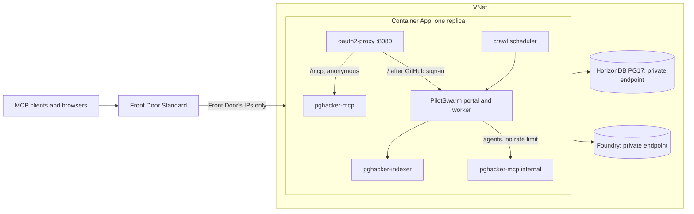

# Deploying pghacker-mcp to Azure

This deploys pghacker-mcp in production mode. Users index whatever they ask for, and the deployment starts with the local corpus. [TERRAFORM.md](TERRAFORM.md) documents the Terraform itself: variables, outputs, secrets and state.



- **`https://<front door>/mcp`** is the public MCP endpoint. It is anonymous and read-only, rate-limited per client (`X-Azure-ClientIP`, IPv6 by /64), and serves only requests that came through this Front Door profile (`X-Azure-FDID`).
- **`https://<front door>/`** is the PilotSwarm portal. Users sign in with GitHub, and only members of your configured `github_org`/`github_team` (or `github_users`) get in. Members are PilotSwarm `user`s (`portal_role`).
  - oauth2-proxy tells the portal who signed in through headers, which PilotSwarm's `proxy` auth provider reads. PilotSwarm 0.8.2's browser app doesn't support that provider, so the image patches support in (`scripts/lib/portal-spa.mjs`).
  - The patch is pinned to the release's bundle and fails the build on any other: re-check it when upgrading PilotSwarm, and drop it once [microsoft/PilotSwarm#154](https://github.com/microsoft/PilotSwarm/issues/154) is fixed.
- **Models** come from Azure AI Foundry: `gpt-6.1-sol` is the portal's default, `gpt-6-luna` runs extraction and deduplication, and `text-embedding-3-small` does embeddings. The subscription's policy refuses keys, so the app calls them with its managed identity: a proxy in the supervisor adds an Entra token to each request (`scripts/lib/foundry.mjs`), and nothing in the container holds a key.
- **Production mode**:
  - `add_source` takes any list of the postgresql.org archive (chosen months, a range, or the whole archive, plus seed threads) and any branch, tag or commit of PostgreSQL.
    - A list added without months, `follow` included, queues the whole archive.
    - A version needs no loading: the code tools read any branch, tag or commit of the [commit history](#commit-history), and `add_source` for one says which commit it names, or starts the history's sync when it has none.
  - `follow` retrieves a list's current month again every hour.
  - The indexer's job workers have lanes: worker 0 runs the recurring jobs, and the others run anything.
  - The crawl scheduler keeps extraction sessions busy as long as threads wait, as fast as Foundry allows: it starts 8, adds one a minute while saturated, halves on a 429, and stops at `crawl_max_sessions`. It runs deduplication as extracts arrive.
  - There are no caps on scope or spend. Every thread of whatever users add gets extracted by `gpt-6-luna`.

## The container

`scripts/container.mjs` runs as root under tini. It starts the Foundry proxy on loopback and bootstraps the database (creating it, the roles, extensions, schema and graph, then migrating). It then runs each service as its own user, with an environment that lists only what it needs (`scripts/lib/azure.mjs`):

| Process | User | Gets |
| --- | --- | --- |
| oauth2-proxy | `pgh-proxy` | The GitHub OAuth App's ID and secret, and the cookie secret |
| pghacker-indexer, pghacker-mcp | `pgh-svc` | Their database role (`pgh_indexer`, `pgh_reader`); embeddings through the Foundry proxy |
| PilotSwarm worker and portal, crawl scheduler | `pgh-agent` | `pgh_swarm`, which can create its own schemas but can't read the corpus; models through the Foundry proxy |

Only the bootstrap, which runs once before the services start, gets the administrator's password. No process gets the managed identity's endpoint: the proxy, in the supervisor, uses it, and forwards only to the Foundry account. Agents have PilotSwarm's built-in shell and read mail that anyone can post, so this separation is the containment: an agent's shell can't read another user's environment or files. The database and Foundry accept connections only from the VNet. The health server on 8081 serves the probes:
- `/healthz` fails after 15 minutes of failed bootstraps, or when a service keeps exiting.
- `/readyz` passes when bootstrap is done and oauth2-proxy, pghacker-mcp and the portal answer.

## First deployment

You need the Azure CLI, signed in (`az login`) with Owner on the subscription, Terraform 1.9+, and Node 24 with the local app set up (for the corpus). From the repository root, copy the synthetic example:

```sh
cp deploy/environments/example.tfvars deploy/environments/local.tfvars
```

Replace its placeholder subscription ID, names, region, model capacities, and GitHub access settings with your own. Choose globally unique registry and vault names, and leave `create_app = false` until step 8. Real `.tfvars`, `.tfvars.json`, and `.backend.hcl` files are ignored; do not force-add them or commit secrets, state, or plans.

The remaining commands run from `deploy/terraform` unless they say otherwise. The `local` filenames are examples: use a separate settings file and backend for each environment.

1. **State.**

   ```sh
   ../scripts/bootstrap-state.sh --resource-group "<state-resource-group>" \
     --storage-account "<globally-unique-state-account>" --location "<azure-region>" \
     --subscription "$(az account show --query id --output tsv)" \
     --key pghacker-mcp/local.tfstate > ../environments/local.backend.hcl
   terraform init -backend-config=../environments/local.backend.hcl
   ```

2. **The registry.** This is a targeted apply, so Terraform warns that the plan is incomplete:

   ```sh
   terraform apply -var-file=../environments/local.tfvars -target=azurerm_container_registry.this
   ```

3. **The image.** From the repository root, ACR Tasks builds `Dockerfile` for linux/amd64 (`deploy/acr-build.yaml`):

   ```sh
   acr=$(terraform -chdir=deploy/terraform output -raw acr_name)
   tag=$(git rev-parse --short=12 HEAD)
   az acr run --registry "$acr" --file deploy/acr-build.yaml --set TAG="$tag" .
   az acr repository show --name "$acr" --image "pghacker-mcp:$tag" --query digest --output tsv
   ```

   Set `image = "<your-registry>.azurecr.io/pghacker-mcp@sha256:<digest>"` in `local.tfvars`, using your registry name and the returned digest.

4. **Everything but the app.** This step creates:
   - the VNet, HorizonDB with its parameter group and private endpoint;
   - Foundry with its three deployments and private endpoint;
   - Key Vault and its secrets, the identity, the Container Apps environment, the probe job, and Front Door.

   ```sh
   terraform apply -var-file=../environments/local.tfvars
   ```

5. **The probe.** It bootstraps the database from inside the VNet. It then checks:
   - the extensions, and that BM25, vector, trigram and Cypher queries run as `pgh_reader`;
   - the managed identity's token, and each Foundry deployment through the same proxy as the app's;
   - the archive, git.postgresql.org and GitHub.

   ```sh
   ../scripts/run-job.sh probe | jq .
   ```

   Fix what `failures` lists, then run the probe again until `ok` is true.

6. **The corpus.** Dump the local corpus (with `npm start` running locally), build its seed image from the app image, and restore it before the app exists:

   ```sh
   npm run corpus:dump                             # from the repository root: .runtime/corpus/<id>/
   acr=$(terraform -chdir=deploy/terraform output -raw acr_name)
   cd .runtime/corpus/<id>
   az acr build --registry "$acr" --platform linux/amd64 --image pghacker-seed:<id> \
     --build-arg "APP_IMAGE=$acr.azurecr.io/pghacker-mcp@sha256:<digest>" .
   ```

   Set `seed_image = "<your-registry>.azurecr.io/pghacker-seed:<id>"`, apply (this creates the restore job), and run it:

   ```sh
   terraform apply -var-file=../environments/local.tfvars
   ../scripts/run-job.sh restore | jq '{ok, corpus, rows}'
   ```

   The restore checks that the dump's checksum, migrations and embedding model match. It refuses a database that already has a corpus unless run with `--replace`, and refuses while the indexer is connected. It loads schema `pghacker` and checks every table's row count. The app rebuilds the graph from the tables when it starts.

7. **The GitHub OAuth App.**
   - Register it under your GitHub organization's **Settings > Developer settings > OAuth Apps** (or under your account), with:
     - homepage `terraform output -raw public_url`
     - callback `terraform output -raw oauth_callback_url`
   - Some organizations restrict OAuth Apps. Until an org owner approves this one, GitHub hides org and team membership from it, and every sign-in fails with a 500 (the logs say `user is missing required organization`).
     - To ask for approval, open `https://github.com/settings/connections/applications/<client ID>` and click **Request** next to your organization.
     - Until then, `github_users` (a list of logins) lets those users in. It doesn't follow the team: once the app is approved, keep only the logins that aren't on the team.
   - Store its credentials (TERRAFORM.md, "Key Vault secrets"):

   ```sh
   vault=$(terraform output -raw key_vault_name)
   az keyvault secret set --vault-name "$vault" --name github-client-id --value "<client ID>" --output none
   read -rsp 'Client secret: ' secret && echo
   az keyvault secret set --vault-name "$vault" --name github-client-secret --value "$secret" --output none && unset secret
   ```

8. **The app.** Set `create_app = true` and apply. From then on, never set it back to `false`, which destroys the app.

9. **Check it.** Front Door can take a few minutes to route a new origin.

   ```sh
   mcp=$(terraform output -raw mcp_url)
   curl -s "$mcp" -H 'content-type: application/json' -H 'accept: application/json, text/event-stream' \
     -d '{"jsonrpc":"2.0","id":1,"method":"tools/list","params":{}}' | jq '[.result.tools[].name]'
   ```

   Then open `public_url`. GitHub asks you to sign in, and a team member reaches the portal; anyone else gets 403. In a pghacker Crawler session, `ingest_status` shows the restored corpus and the graph's vertices and edges.

10. **The code.** Unless the corpus brought a commit history, build one ([Commit history](#commit-history)): the code tools have no other source.

## Updates

Build and push a new image (step 3), set its digest as `image`, and apply. Container Apps starts the new revision before it stops the old. The two overlap briefly: the new indexer serves its tools at once, but runs jobs only once the old one has stopped.

### Schema upgrades

Migration numbers name schema changes, not the order production revisions
were deployed. Fresh databases apply them in filename order; an existing
database applies every missing migration and checks the checksums of those
already recorded.

| Migration | Change |
| --- | --- |
| `0013_duplicate_candidates` | Incremental feature/decision duplicate candidates for `find_duplicates`. |
| `0014_commit_graph` | Commit vertices and history edges, full-SHA anchors, and graph projection tracking. |
| `0015_restore_addresses` | The `restore_addresses()` job-queue function; the accompanying ingest code preserves addresses. |
| `0016_retire_snapshots` | Drops snapshot tables and capture functions; cancels queued or running `code_snapshot` jobs. |
| `0017_extraction_lease_versions` | Records each leased thread's content version so mail arriving during extraction remains pending. |
| `0018_feature_release_at` | Tracks a release claim's thread evidence date so older backfill cannot overwrite newer evidence. |

Production applied `0016` before the later-stacked `0013`–`0015`.
**Do not roll back to an image that reads snapshot tables**, even to undo
a lower-numbered migration: those tables no longer exist. A history-only
image can, however, predate `0014`: the previous production image,
`33616a4`, already includes `0016` and is compatible with the schema through
`0018`. For that target, use the [history-only rollback procedure](#rollback-to-a-history-only-image-before-0014)
below. Keep the added columns and tables in place; that image ignores them.
Applied migration files are immutable, including their comments, because
their checksums are verified on every start.

### Email addresses

An image with migration `0015_restore_addresses` stores mail's email addresses as written: subjects, bodies, patches and senders' names. Mail stored before it has `[email]` in their place, and senders' names without them, until restored. After deploying it, as `pgh_indexer` from the operator environment (Graph index preparation):

```sql
SELECT * FROM pghacker.restore_addresses();
```

- It queues a `restore_addresses` job per stored month, which downloads the month again, and one per 200 messages from thread pages, which are fetched one by one at the archive's rate (2 requests a second). `ingest_status` shows the jobs.
- They change only text stored exactly as ingest once made it of the archive's, and count the rest as `differs`. Changed chunks are embedded again through Foundry, changed patches are indexed again by the `patch_lines` job, and the graph follows.
- Running it again restores whatever is left; a job that's queued or running is left as it is.

### Graph index preparation

The graph-index upgrade requires preparation **before deploying the new service
revision**. Fresh bootstrap creates concrete edge-ID indexes atomically with new
labels; migration `0009_graph_indexes` creates mapping endpoint indexes only on a
table checked empty under a write-blocking lock. Existing missing AGE indexes or
populated mappings fail startup with operator guidance instead of launching a
blocking build. Applied migration markers alone do not satisfy readiness.

From an approved private-network operator environment, use the established
`PGHACKER_ADMIN_DATABASE_URL` (graph owner) and, for read-only checks,
`PGHACKER_INDEXER_DATABASE_URL`. Never pass those credentials to the public
reader, portal agents, or serving indexer. No new ownership/grants are needed:
the graph owner must already be able to `SET ROLE pgh_indexer` for mapping DDL.
The script does not bootstrap roles, run migrations/jobs, deploy, or drop indexes.

```sh
node scripts/graph-indexes.mjs --plan --out /protected/operator/graph-indexes.json
node scripts/graph-indexes.mjs --check
# Only after approval of the exact manifest, capacity/window, and statement budget:
node scripts/graph-indexes.mjs --apply \
  --plan-file /protected/operator/graph-indexes.json --build-timeout-ms <approved-ms>
```

Plan output includes existing/parent index definitions and blocked states.
Manifests contain no credentials, are created owner-only without overwriting a
file, and bind the target database/server, relation OIDs, owners, and definitions.
An unexpected label, replaced table, incompatible/invalid index, or new missing
requirement needs a newly reviewed plan. Equivalent valid indexes under another
name are reused; `IF NOT EXISTS` is not treated as proof.

The script uses one persistent autocommit psql session, a separate preparation
advisory lock, and one concurrent build at a time. It checks exact physical ID
duplicates before a selected AGE build; it does not repair them or claim a full
graph-data audit. It sets a two-second lock timeout for its checks, disables
parallel maintenance workers for that session, and requires an explicit build
deadline. The build itself waits for older transactions, such as a running
graph sync, for as long as that deadline allows: a lock timeout would cancel it
and leave an invalid index.
Before applying, approve disk reserve for remaining indexes, measured temporary
build/WAL space and growth, and compare producer/read latency under concurrent
extraction/full sync. Do not change jobs or terminate other sessions to bypass a
writer/snapshot wait without separate permission.

For an approved canary, add `--only pghacker_graph.MODIFIES_id_idx` if that index
is in the manifest. A completed subset reports the remaining requirements and
exits 2 until the full catalog is ready. Resume the same reviewed manifest only
when scope is unchanged; completed equivalent indexes are skipped. Failure exits
nonzero, reports completed work and SQLSTATE, and never automatically drops an
invalid concurrent index. SIGINT/SIGTERM cancels the owned psql operation; inspect
reported active/invalid state before any separately approved cleanup.

Monitor JSON progress and `pg_stat_progress_create_index` phases/lockers,
authorized activity/wait information, disk, WAL/replica lag, and service
latency/timeouts. A concurrent build still scans and waits, and can interfere
with maintenance and long full-sync transactions. Do not infer a total sync
speedup from a selective lookup plan.

Recovery or rollback requires separate approval for the exact added index.
After confirming no active build and no constraint dependency, the appropriate
owner can drop one identified addition with `DROP INDEX CONCURRENTLY` outside a
transaction, then prepare again. Never drop existing AGE endpoint/parent
indexes, reset the graph, or delete the migration ledger row. Additive valid
indexes can remain when application code is rolled back; fence any incremental
consumer before removing its prerequisites.

Before deployment, require successful catalog checks, approved exact graph/data
audits, realistic before/after ID and both endpoint plans, and resource/latency
gates. Production DDL, cleanup, and deployment are distinct approvals; a script
flag is not user authorization. Older corpus seed manifests without the new
migration still fail strict restore compatibility: regenerate them with the
approved new image rather than weakening the check. `docs/design.md` is not
part of this change.

The commit history's edge labels, `BACKPATCH_OF` and `COMMITTED` (migration
`0014_commit_graph`), need no preparation: the new image's bootstrap creates
them empty, with their `id`, `start_id` and `end_id` indexes, in the same
transaction, and `--check` then passes.

## Commit history

The code tools read PostgreSQL's whole commit history ([README](../README.md#commit-history), [the search design](../docs/search-design.md)), their only source: a deployment has no code to read until one is installed. All tools are listed regardless; check `get_ontology.loaded.code` or `list_sources.history` for readiness. Installing it, or rebuilding it from scratch, is a one-off execution of the probe job, given 4 vCPU and 8 GiB, that runs `scripts/history-build.mjs`:

```sh
../scripts/run-job.sh history | jq '{ok, error, build, verify: (.verify // {} | {ms, commits, files, mismatch_count, mismatches})}'
```

It fetches every branch and tag of `https://git.postgresql.org/git/postgresql.git` into a bare clone on the job's disk, builds the history into schema `pghacker_history`, and swaps it into `pghacker`. It then rebuilds every file of the branch heads and of 40 random commits and compares them with git, for the rest of the job's hour. `ok` is true when nothing differed.
- The code tools read it at once: `search`, `grep`, `read_file`, `list_files` and `blame` read any commit, and paths below `/branch/<name>/`, `/tag/<name>/` and `/commit/<rev>/`; `get_commit` and `search_commits` answer as `git show` and `git log`.
- The indexer's hourly `code_history_sync` job fetches new commits into its own clone and applies them. The clone is about 850 MB in `PGHACKER_GIT_DIR`, fetched again after a restart.
- The next `resolve_anchors` run resolves mail's file anchors to the history's paths.
- `PGHACKER_CODE_HISTORY` in `app_env` names another schema for the code tools to read; unset, `pghacker`. It is not a switch between engines.

Check `tools/list` (First deployment, step 9) and run the evaluation.

**Retired snapshots.** Before the history, the code tools read source snapshots (15 in production: 48M lines, 5.9 GB). Migration `0016_retire_snapshots` drops their tables (`code_snapshots`, `code_files`, `code_lines`) and change capture, and records the graph keys of their files and of the history's. The incremental graph sync moves File and Subsystem vertices and `PART_OF` edges onto the history: a File is `loaded` when the history has its path. Retirement alone does not request a full sync; the `0014` projection upgrade and each history install do separately. It also cancels any queued or running `code_snapshot` job. Snapshot-reading images are incompatible after this migration: [fix forward](#schema-upgrades).

**The graph.** An image with migration `0014_commit_graph` projects the installed history's commits into the graph (README, "How the graph follows the tables"): a `Commit` vertex for each of its commits, and their `MODIFIES`, `DISCUSSED_IN`, `BACKPATCH_OF` and `COMMITTED` edges. In the recorded October 2026 production sample of 105,545 commits, that added about 730,000 elements, 18% more by element count.
- The upgrade asks for one full graph sync, which also re-keys mail's commit citations by their full SHA. So does each `history build --install`.
- In local measurements, the history's part took 20 s of a full sync. Element-count growth does not establish a production runtime; inspect current `ingest_status` and sync logs instead.
- The history's writers record their changes for the incremental sync: an hourly sync's few commits cost a batch of milliseconds.

### Rollback to a history-only image before 0014

This procedure is for a compatible **history-only** image that predates
`0014_commit_graph`, specifically the previous production image `33616a4`.
It already includes snapshot retirement (`0016`); earlier snapshot-reading
images cannot run against this database.

After rolling back to that image, as `pgh_indexer`, cancel the queued or
running `duplicates` and `restore_addresses` jobs it does not recognize,
then remove the graph changes whose labels its graph sync does not know
and request a full sync:

```sql
UPDATE pghacker.jobs SET state = 'cancelled'
WHERE kind IN ('duplicates', 'restore_addresses') AND state IN ('queued', 'running');
DELETE FROM pghacker.graph_changes WHERE label IN ('BACKPATCH_OF', 'COMMITTED');
SELECT pghacker.graph_request_full('rolled back past 0014');
```

Without cancellation, those jobs fail as unknown kinds and can leave failed
restore jobs to be re-queued. Do not queue them again until rolling forward.
The older image's full sync brings the graph to its own projection: it drops
the `BACKPATCH_OF` and `COMMITTED` counts and bookkeeping but leaves their
edges in AGE. They remain there until the next roll-forward's full sync:
the newer image finds the counts missing, removes those edges and projects
them again. The other added columns and tables remain in place and are
ignored by the older image; do not drop them or remove migration records.

Schema compatibility does not preserve the newer ingestion and extraction
semantics. `33616a4` redacts email addresses in mail it ingests and applies
reused features' releases in extraction order without maintaining
`features.release_at`. A regressed release can therefore retain a newer,
stale evidence date after rolling forward; the newer date guard does not
automatically repair it. Features the older image creates also have no
`release_at`: after rolling forward, any later dated claim can replace
their release, even a claim from an older thread.

Consider `PGHACKER_CRAWL=off` to pause automatic extraction during the
rollback; this does not stop mail ingestion. Before any extraction
resumes after rolling forward, reconcile releases the older extractor set
or changed, including their evidence dates. For missing dates, use the same
conservative backfill as `0018`: the maximum `threads.last_at` linked through
`feature_threads`. Scope a separately reviewed repair to the affected
features with a non-NULL release and NULL `release_at`; the already-applied
migration will not run this backfill again. Existing non-NULL dates need
comparison with the actual release evidence, not a blind reset.

After rolling forward, queue address restoration again, even if no restore
job was cancelled, to recover addresses in mail ingested by the older image:

```sql
SELECT * FROM pghacker.restore_addresses();
```

## Production mode in use

Ask a **pghacker Crawler** session in the portal, for example:
- "Index pgsql-hackers since 2025-01 and follow it."
- "Add the PG18 source."

It confirms the scope of large requests, since a whole archive is decades of mail. It reports what `add_source` queued, and follows retrieval and extraction with `ingest_status`.

The crawl scheduler's progress is in the container's log, with `[crawl]` lines. To stop extraction, set `app_env = { PGHACKER_CRAWL = "off" }` and apply. The other knobs are `crawl_start_sessions`, `crawl_max_sessions` and the Foundry capacities in `foundry_deployments`.

Extraction leases new mail as it arrives, for up to half of the threads, and fills in the rest of the archive from the newest thread back (README, "The order of extraction"). `ingest_status.extraction.lanes`, and the log's `[crawl] Backlog:` lines every 10 minutes, show both lanes. To tune them, set `PGHACKER_EXTRACTION_NEW_MAIL_SHARE` or `PGHACKER_EXTRACTION_NEW_MAIL_DAYS` in `app_env`. To go back to the order before the lanes, the largest threads never extracted first, set `app_env = { PGHACKER_EXTRACTION_ORDER = "largest" }` and apply; the app restarts with it.

The supervisor forwards those extraction settings and `PGHACKER_CODE_HISTORY`
explicitly. `app_env` is not a general pass-through to the Rust services:
server-only pool, timeout, archive and graph-reconcile settings use their
defaults unless the supervisor's allowlist is changed.

## Evaluating the deployment

The 30-question evaluation runs local agents against the deployment's public endpoint, and checks their citations and cited commits there; questions q21 to q30 need the commit history. From the repository root:

```sh
npm run stop
PGHACKER_AGENT_MCP_URL="$(terraform -chdir=deploy/terraform output -raw mcp_url)" npm start   # detached, in another terminal
npm run eval -- --mcp-url "$(terraform -chdir=deploy/terraform output -raw mcp_url)" --concurrency 1 --results eval/RESULTS-azure.md
```

Concurrency 1 keeps the agents within the endpoint's per-client rate limit.

## Operations

- **Logs.** Log Analytics (`terraform output -raw log_analytics_workspace_id`), table `ContainerAppConsoleLogs_CL`. Each line is prefixed with its process: `[supervisor]`, `[indexer]`, `[mcp]`, `[swarm]`, `[crawl]`, `[oauth2-proxy]`.
- **Restart.** `az containerapp revision restart` on the active revision. A restart drops live portal sessions' turns; extraction leases lapse after 20 minutes and their threads are extracted again.
- **Graph sync.** The indexer applies the changes that triggers capture in short batches (README, "How the graph follows the tables").
  - Each batch that changes the graph logs `synced the graph` with its `mode`, `changes` and `ms`. `ingest_status` shows `pending_changes`, `oldest_pending_at` and the last full sync.
  - A full sync runs once after the upgrade that installs the change capture, after an upgrade that changes what the graph projects, after a restore or a commit-history install, weekly as a reconcile, and when asked for: `pghacker-indexer graph-reconcile`, or `SELECT pghacker.graph_request_full('why')` as `pgh_indexer`. A reconcile that changes the graph logs a warning: the change capture missed something, or changes were committed while it ran.
- **Secrets.**
  - Rotating the GitHub OAuth App's secret means a new `github-client-secret` version and then a restart.
  - Replacing a role's `random_password` (`terraform apply -replace=...`) changes the vault secret. The next bootstrap sets it on the role.
- **Front Door's ranges** change now and then. Every apply reads the `AzureFrontDoor.Backend` tag again.
- **Limits.**
  - The app has 4 vCPU and 8 GiB of memory; each extraction session runs a Copilot CLI process, and the scheduler holds back above 85% memory use.
  - HorizonDB has 32 vCores (`horizondb_vcores`).
  - `gpt-6-luna` has the subscription's whole 1M tokens per minute in westus3.
  - The ephemeral disk holds the commit history's clone (about 850 MB, once a history is installed) and no mbox files.
