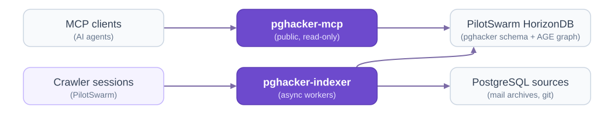

# pghacker-mcp design

*October, 2026 | Maxim Lukiyanov | Azure PostgreSQL*

The scope waves and test subsets below record the original rollout plan.
The current implementation serves mail and the whole installed commit history,
not a snapshot backend or only the PG19 subset; the [README](../README.md)
and [search design](search-design.md) describe its current configuration and limits.

## Why pghacker-mcp

PostgreSQL's design history lives in about 600K pgsql-hackers messages and the source tree. Asked why a feature works as it does, what happened to SQL/PGQ, or how a committer would review a patch, agents search it blindly, taking minutes and missing evidence. pghacker-mcp indexes both once and answers in seconds, with citations, for PostgreSQL developers and builders.

## Scope

| Wave | Scope |
| --- | --- |
| **1** | Local PilotSwarm: pgsql-hackers slices become threads, authors, features, decisions, positions, anchors and an AGE graph, with full-text, semantic and hybrid search, `author_perspective` and code search over a PG19 subset. Done when code search matches ripgrep on replayed agent searches and 20 test questions get correct, cited answers. |
| **2** | Commits and diffs for the PG19 subset: history tools, diff search, `Discussion:` links to threads. |
| **3** | Mort: crawler sessions, both containers, public endpoint, full PG19 and archive, hourly refresh. |
| **4** | Rest of the Loop: patches, commit and PR graph data, feature trends, semantic code search, welcome page, telemetry. Out of scope: CommitFest site, docs, other lists, MCP App UI. |

## Architecture

- **pghacker-mcp:** async Rust (tokio, axum, `rmcp`), stateless, public without sign-in, rate-limited per IP. No LLM calls beyond query embeddings; read-only role with a 10-second default statement timeout. Code searches temporarily apply their own budgets (below).
- **pghacker-indexer:** async Rust (tokio, `tokio-postgres`, `mail-parser`, `gix`), internal. Async workers fetch, parse and embed sources and build the graph; MCP tools serve crawler sessions.
- **Crawler sessions:** a `pghacker-crawler` package on PilotSwarm's generic crawler. A supervisor picks sources; extractor and deduplicator agents use the configured model (`gpt-6-luna` by default for both).

Both services use HorizonDB directly: PilotSwarm facts and graph API can't run pg\_trgm, BM25 or Cypher. Waves 1–2 run on the local starter plus AGE, pgvector, pg\_textsearch.

## Data model

Tables in schema `pghacker` are authoritative. Messages and extracts support three search modes: `fulltext` ranks by BM25 (pg_textsearch), `semantic` by pgvector similarity, and `hybrid` fuses both rankings. pg_trgm indexes names, paths, code and diffs.

**Extracts** cite Message-IDs and verbatim quotes: **features** (proposal to commit, revert or rejection; release), **decisions** (outcome, alternatives, rationale) and **positions** (an author's stance in a thread).

**Graph.** The AGE graph `pghacker_graph` adapts the `postgres-hackers/v2` node types:

| Source | Edges |
| --- | --- |
| **Mail** | `AUTHORED` Author → Message, `REPLIES_TO` Message → Message, `IN_THREAD` Message → Thread |
| **Anchors** | `MENTIONS` Message → File, Commit, CommitFestEntry or Release; `PART_OF` File → Subsystem |
| **Extracts** | `DISCUSSES` Thread → Feature, `DECIDES` Decision → Feature, `TARGETS` Feature → Release, `IMPLEMENTS` File → Feature, `HOLDS` Author → Position, `ABOUT` Position → Feature or Decision, `EVIDENCED_BY` extract → Message |
| **git history** | `MODIFIES` Commit → File, `DISCUSSED_IN` Commit → Thread, `BACKPATCH_OF` other group member → first Commit, `COMMITTED` Author → Commit (the one matching the commit's author name) |

**Anchors.** PostgreSQL has no pull requests: references map to CommitFest entries, posted patches, Message-IDs and verbatim quotes. File anchors keep the source-root path and resolve to a readable `/branch/<name>/<path>` or `/commit/<sha>/<path>` in the commit history; abbreviated commit anchors resolve to full SHAs when the history has them. Graph File keys remain `file:<path>`.

## Ingestion

Deterministic code handles verbatim facts and models only judgments; the agent-built v2 graph needed 127 recovery batches for two months of mail. Crawler sessions use these indexer tools:

- **Sources:** `add_source`, `remove_source` and `list_sources` manage mailing lists. Async workers retrieve monthly mbox and flat thread pages, thread mail, match authors by email, record patches, chunk and embed; a followed list's current month is retrieved again hourly. Local `test-slices` mode accepts the configured slices; Azure's `open` mode accepts arbitrary archive lists, months and threads. Code versions are lookups in an operator-built commit history, not requests to load a tree; its hourly sync fetches new commits. Path prefixes are chosen when building the history, not by `add_source`.
- **Email addresses:** subjects, bodies, patches and senders' names keep addresses as written, and a sender without a name appears as their address. These can reach tool output and graph properties. The sender-address identity mapping, `author_emails`, is unreadable by `pgh_reader` and is not read by the graph. `restore_addresses()` queues archive retrieval to restore older redacted text when it still equals the former ingest output.
- **Progress:** `ingest_status` reports what each source has retrieved, parsed and extracted.
- **Extraction:** `next_extraction_batch` leases threads never extracted, or changed since extraction, with messages, authors and anchors. By default it splits slots between new mail (latest activity within 7 days, oldest first, up to half the slots while both lanes have work) and backfill (newest activity first); `largest` is an explicit legacy ordering option. The lease records the thread's content version, so mail arriving during it is extracted again. Before submitting, `match_extracts` finds existing features and decisions like each draft, and the model reuses one or declares a new one. `submit_extracts` rejects unreviewed near-duplicates, citations outside the thread and inexact quotes. Restated positions replace earlier ones on the same subject in that thread, except merge-moved positions kept for undo; a reused feature's release follows the latest thread evidence, not extraction order.
- **Repair:** the indexer finds duplicate candidates incrementally as extracts arrive; `find_duplicates` lists them and `mark_distinct` records pairs judged different. `merge_authors` and `merge_extracts` make logged, reversible merges; `undo_merge` reverses them.

## MCP tools

**Mail and graph:** `get_thread`, `search_authors`, `get_author`, `get_ontology`, and three tools that take `mode` (`fulltext`, `semantic` or `hybrid`, the default): `search_threads`, `search_extracts` and `author_perspective` (cited positions on a topic).

**SQL:** `query`: after a `sqlparser` check (one statement, no transaction control), it runs the SQL, AGE `cypher()` included, in a rolled-back read-only transaction with a 10-second statement timeout and returns up to `max_rows` rows as CSV (default 100, at most 1,000). SQL is at most 64 KiB and CSV at most 1 MiB before a truncation banner and row count. Its connection checkout remains bounded at 5 seconds and its whole-call backstop at 20 seconds. It reads results in PostgreSQL's text format, through a vendored `tokio-postgres` fork (`bind_text`).

**Code search** has a first-class `search` plus a `grep` tool.

| `search` parameters | Values (grep equivalent) |
| --- | --- |
| **query, match** | Text, regex or name, or a list meaning any; `match` sets which (`-e`, `-E`) |
| **version, history** | One commit's tree (default: newest release branch), or lines across `all`, a revision's ancestors or `A..B`; `history` is lines-only, without context or virtual-root paths |
| **case_sensitive, whole_word** | Case-sensitive by default; identifiers ignore case (`-i`, `-w`) |
| **paths, include, exclude, also, not** | At one commit, paths may be globs; history takes file/folder paths. Include/exclude globs work in both; also/not constrain line text (`\| grep`, `-v`) |
| **output, group_by, context** | At one commit: lines, files or counts, per file or match, with at most 20 context lines (`-l`, `-c`, `-C`); `history` uses `lines` and `file` only |
| **limit, offset, order, budget_ms** | A page with totals (default 100, at most 2,000), path or coverage order at one commit, and a time budget (`head`, `-m`); history results are in path order |

`search` at one commit (no `history`) defaults to 4 seconds, at most 10;
`search` over a range of commits (`history`), `grep`, `search_patches` and
`search_commits` default to 10 seconds, at most 15. All expose `budget_ms`
and temporarily override the reader's default statement timeout. `search`
and `grep` candidate reads stop at 200,000; incomplete `search` totals are lower bounds,
while incomplete `grep` searches fail without partial pipeline counts.
See the [search design](search-design.md#indexes-and-queries) for deadline
qualifications and the [README](../README.md#code-search-budgets-and-large-archives)
for each tool's row and output caps.

Results add totals, cut and budget flags, and, at one commit, similar names when nothing matches. `grep` takes grep command lines with their folder: flags such as `-E`, `-F` and `-P` set the dialect, and trailing `head`, `tail`, `wc -l`, `sort | uniq -c`, `cut -c`, `cat` and `grep` stages are interpreted in memory. `read_file` and `list_files` read commit trees; `search_commits`, `get_commit` and `blame` provide the equivalents of git log, show and blame. All tools are always listed; `get_ontology.loaded.code` reports whether a history is available.

## Test data

| Wave | Subset and purpose |
| --- | --- |
| **1** | June–July 2026 mbox (≈5K messages, 190 MB), to compare with the v2 graph |
| **1** | SQL/PGQ and SQL/JSON threads from archive search: reverted and uncommitted work |
| **1** | `src/backend/{parser,utils/adt}`, `src/include/nodes` and `contrib/pg_trgm` at a pinned `REL_19_STABLE` SHA: 206 files with the SQL/JSON code |
| **2** | The 540 of 3,662 PG19 commits since 2025-07-01 that touch that subset |
| **3** | The full tree (7,652 files) and archive (≈600K messages) |

## Risks

- **Extensions:** HorizonDB must host AGE, pgvector, pg_trgm and pg_textsearch 1.5+.
- **Public SQL:** if grants prove weak, use a separate database or allow only Cypher templates.
- **Quality and scale:** tune dedup, threading and identity early; 1–2M chunk vectors need 6–12 GB.

### References

- [PilotSwarm](https://github.com/microsoft/PilotSwarm) and its [pgsql-hackers crawler spec](https://github.com/microsoft/PilotSwarm/blob/main/docs/proposals/enhancedfactstore/11-pgsql-hackers-sample-crawler.md).
